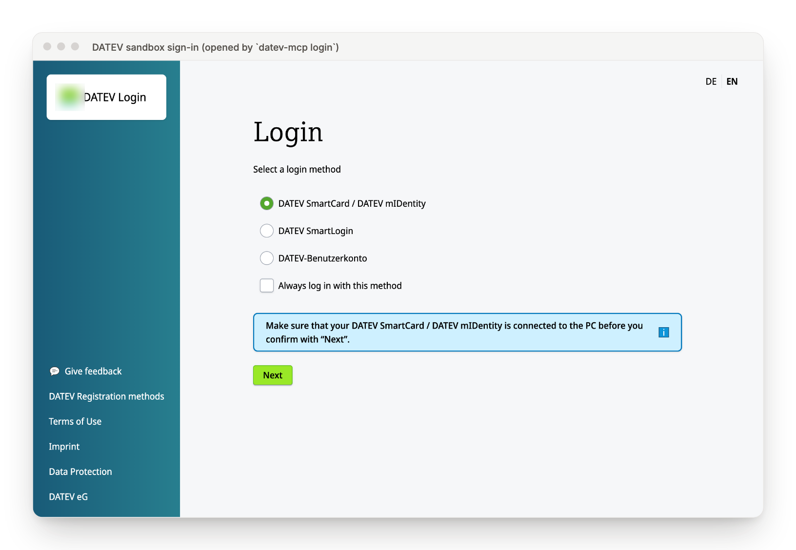
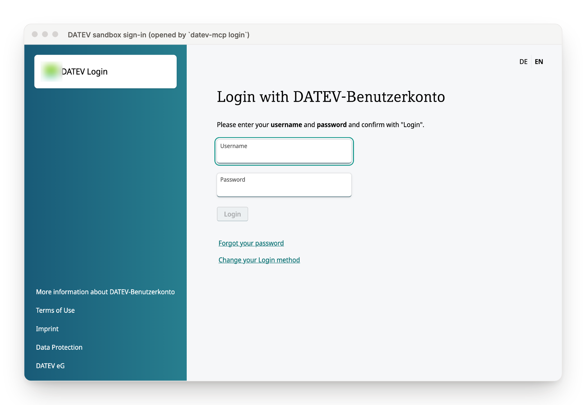
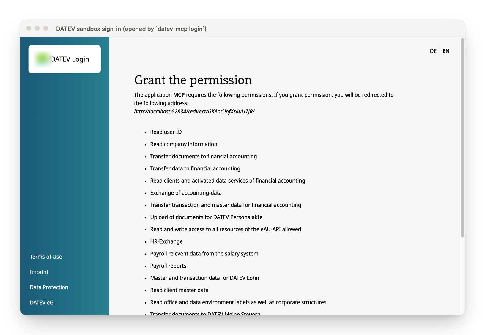
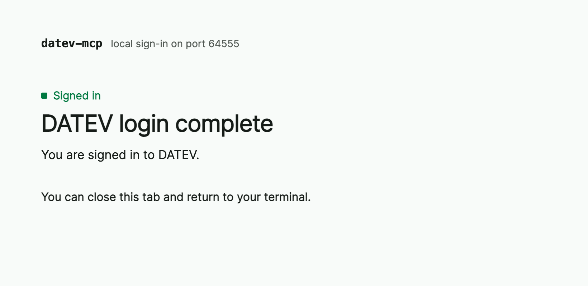
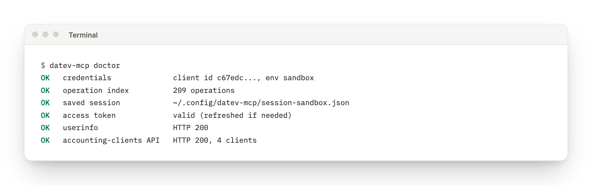
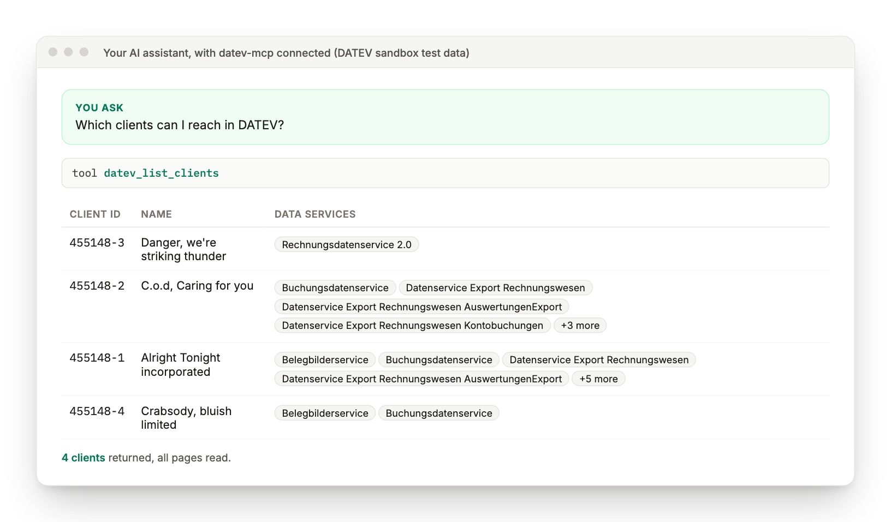
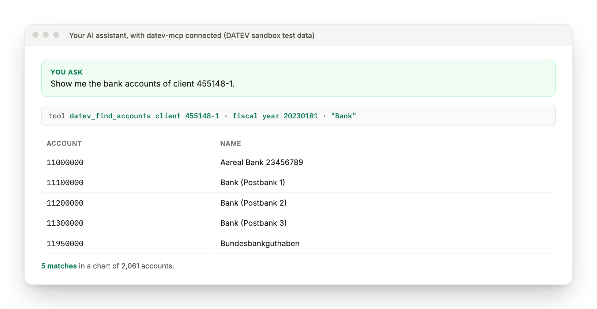
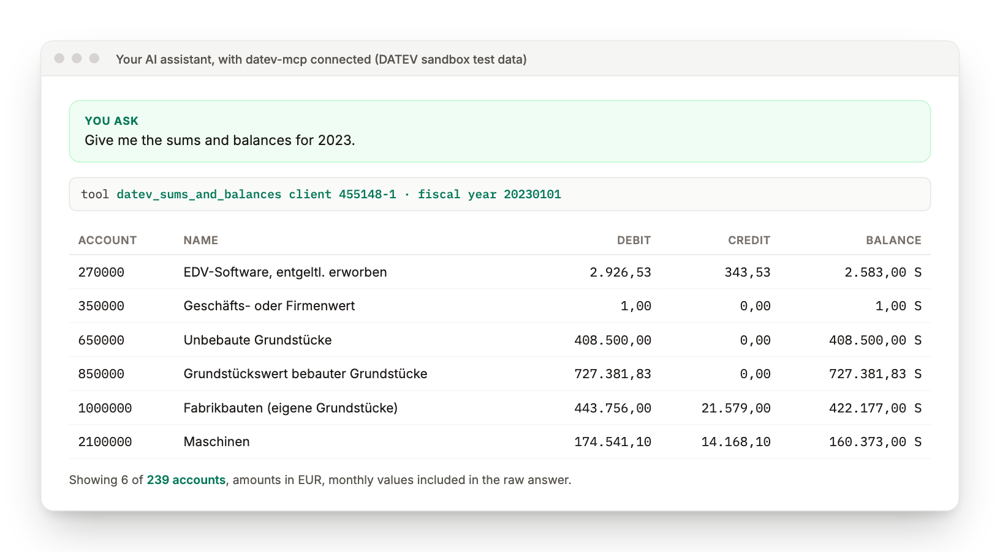
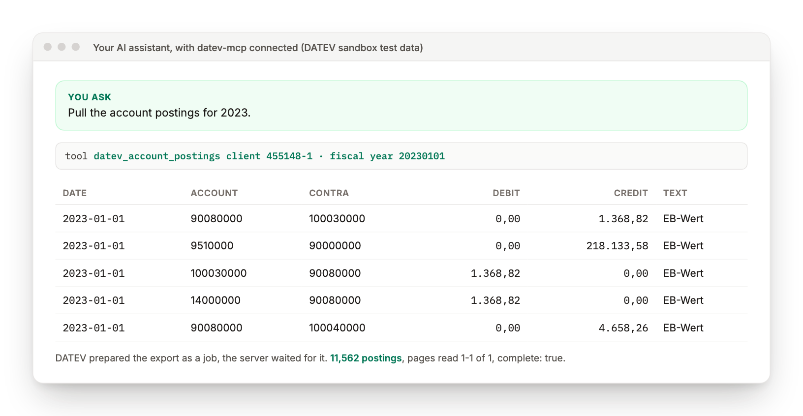
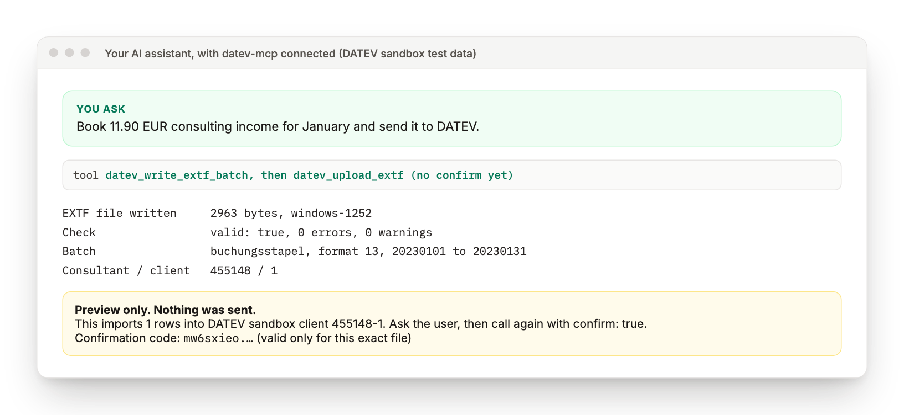

# datev-mcp

Ask your AI assistant about your DATEV bookkeeping, payroll and documents in plain words, and let it act on them only after you have seen exactly what it will do.


## What this is, in plain words

DATEV holds the books of most German small and medium businesses. Getting a number out of it, uploading a receipt, or checking a payroll export usually means logging in, clicking through several screens and copying values by hand.

datev-mcp connects an AI assistant (Claude, Cursor, VS Code Copilot or any client that speaks the Model Context Protocol) to the official DATEV APIs. You ask "what is the balance on account 1200 for client 455148-1 this year?" and the assistant fetches it from DATEV for you. When an action would change data, such as uploading a document or importing bookings, the assistant first shows you a preview and does nothing until you agree.

It is built for tax advisors, bookkeepers, and the developers who build tools for them.

## What you get

- **Answers without clicking.** Clients, fiscal years, sums and balances, account postings and the chart of accounts come straight from DATEV into the conversation.
- **Nothing changes behind your back.** Every write that changes bookings, files or records returns a preview first. The real call only runs with a one-time confirmation code that matches that exact preview, so the assistant cannot quietly swap the file or the target client. The one exception is `datev_account_postings`, which starts DATEV's read-only postings export job directly.
- **Every DATEV operation, not a hand-picked few.** All 209 operations across 23 DATEV API specifications are indexed and can be searched and described (health checks only on request), with thirteen focused tools for the everyday cases. Every operation that takes a file upload can be sent with `datev_upload_file`, after a preview.
- **Your files stay yours.** The server refuses to send anything from hidden folders (where SSH keys and cloud logins live) or anything that looks like a key or credentials file.
- **Honest answers.** If DATEV returns an error, an incomplete page or an answer shape the accounting tools do not understand, you get told instead of a fake empty list. Rows the tools cannot read are counted in the answer (`skipped_rows`, `rows_without_account`), and a chart of accounts with no readable row is refused.

## From zero to your first answer

You need a DATEV developer account with an app registered for the sandbox, and Node.js 22 or newer. The DATEV portal steps are in [docs/SETUP.md](docs/SETUP.md). Plan about 15 minutes the first time.

Every screenshot below was taken on 2026-11-07 against the DATEV sandbox, which holds test data only. The DATEV logo is blurred on purpose; this project is not affiliated with DATEV.

### 1. Install and build

```bash
git clone https://github.com/mjmirza/datev-mcp.git
cd datev-mcp
npm install
npm run specs      # downloads DATEV's public API specs into specs/ (never committed)
npm run build
```

### 2. Add your DATEV app credentials

For production, inject the client id and secret from a password manager when the server starts, so the secret is never written to disk. For sandbox development a local settings file is fine.

```bash
cp .env/.env.example .env/.env.local
# edit .env/.env.local: DATEV_CLIENT_ID and DATEV_CLIENT_SECRET (sandbox only)
```

Git ignores `.env/.env.local`, but the file is plain text, so do not keep a production secret in it. Every setting is explained in [.env/README.md](.env/README.md). Never paste the secret into a chat.

### 3. Sign in once

```bash
node --env-file=.env/.env.local dist/index.js services
node --env-file=.env/.env.local dist/index.js login --services accounting-dataexchange,accounting-documents,accounting-extf-files
```

Pick the data services you will use from the `services` list. DATEV allows only their scopes, so the server asks for nothing more.

A browser window opens at DATEV's sandbox login. These are the four screens you will see.

**3a. Choose how to sign in.** For a sandbox test account, pick `DATEV-Benutzerkonto` and press Next.



**3b. Enter your sandbox username and password.** You type these into DATEV's own page. datev-mcp never sees them.



**3c. Grant the permissions.** DATEV lists what the app may do and where it will send you back (a one-time `localhost` address on your own machine). Press "I agree" at the bottom.



**3d. Done.** The browser shows a short confirmation and your terminal prints `Connected to DATEV sandbox as <your name>` with the date and time the connection stays valid. The session is saved encrypted on your machine. `dist/index.js status` shows the connection at any time, `dist/index.js disconnect` ends it.



Working over SSH, or want a different browser? Set `DATEV_MCP_NO_BROWSER=1` and the command only prints the link.

### 4. Check that everything works

```bash
node --env-file=.env/.env.local dist/index.js doctor
```

Six green lines mean the credentials, the operation index, the saved session, the token and two live DATEV calls all work.



### 5. Connect your AI client

Example for Claude Code. Other MCP clients take the same command and arguments.

```bash
claude mcp add datev -- node --env-file=/absolute/path/to/datev-mcp/.env/.env.local /absolute/path/to/datev-mcp/dist/index.js
```

### 6. Ask your first question

Type "which clients can I reach in DATEV?". That is your first win.

## What the answers look like

These are real answers from the DATEV sandbox, unedited apart from shortening long lists. The questions are what you type, the tool line is what your assistant calls behind the scenes.

**Your clients and the data services each one has switched on.**



**Search the client's real chart of accounts in plain words.**



**Sums and balances (Summen- und Saldenliste) for a fiscal year.**



**Every posted booking of the year.** DATEV prepares this export as a background job. The server waits for it, reads all pages and tells you whether the list is complete.



**Booking something. Preview first, nothing sent.** The assistant builds and checks a DATEV booking file, then shows you what it would import and where. It can only send it after you agree, using the confirmation code tied to this exact file.



## The tools

| Tool | What it does | Changes data |
|---|---|---|
| `datev_list_clients` | Lists the clients (Mandanten) your login can see | No |
| `datev_list_fiscal_years` | Lists a client's fiscal years, after checking the client switched on Datenservice Export Rechnungswesen | No |
| `datev_sums_and_balances` | Summen- und Saldenliste, filterable by account prefix | No |
| `datev_account_postings` | Posted bookings for a fiscal year, all pages, resumable | No |
| `datev_find_accounts` | Searches the client's real chart of accounts (SKR03, SKR04 or custom) | No |
| `datev_validate_extf` | Checks a DATEV EXTF booking file locally, before anything is sent | No |
| `datev_write_extf_batch` | Builds a valid EXTF booking file from rows you describe, cost centres included | No, writes a local file |
| `datev_upload_extf` | Imports an EXTF booking file into a client with Buchungsdatenservice, waits for DATEV's import result, refuses to send the same file twice by accident | Yes, preview first |
| `datev_extf_job` | Shows the result of an earlier EXTF import | No |
| `datev_upload_document` | Uploads a receipt or invoice to Belegbilderservice or Buchungsdatenservice, with the client's own document types | Yes, preview first |
| `datev_document_types` | Lists the document types (Belegtypen) a client accepts | No |
| `datev_check_client` | Checks with consultant and client number that a data service may be used for a client | No |
| `datev_upload_file` | Sends local files to any DATEV operation that takes a multipart upload | Yes, preview first |
| `datev_search_operations` | Finds DATEV operations by words (health checks with `include_health`) | No |
| `datev_describe_operation` | Shows the parameters an operation needs | No |
| `datev_connection_status` | Shows whether the DATEV connection is active, for whom, and until when | No |
| `datev_compliance` | Shows how this installation meets DATEV's interface requirements | No |
| `datev_call` | Calls a DATEV operation by id, reads directly, writes with preview. Sends JSON or text. Files go through `datev_upload_file` | Writes need confirmation |

## How well it is tested

Type check, tests and scenarios were re-run on 2026-11-10. The planted bug check and the live sandbox numbers are from 2026-11-07 and 2026-11-08. The method and how to reproduce each one is in [docs/VALIDATION.md](docs/VALIDATION.md).

| Check | Result |
|---|---|
| Offline scenarios across all 209 operations | 28,582 of 28,582 passing |
| Planted bugs the scenarios had to catch | 5 of 5 caught |
| Unit and integration tests | 310 of 310 passing |
| Live DATEV sandbox, read operations reached | 71, with 38 returning data |
| Independent review by a second AI model (Codex), four passes | 46 of 48 findings fixed. Two known limits remain, listed in [SECURITY.md](docs/SECURITY.md) |

Per operation results are in [docs/ENDPOINT-AUDIT.md](docs/ENDPOINT-AUDIT.md).

## Safety in one paragraph

Operation calls only go to the DATEV hosts named in DATEV's specs and never follow a redirect, so your credentials cannot be forwarded elsewhere by them. Token, revoke, userinfo and `doctor` calls refuse redirects too. Logins use OAuth with PKCE, DATEV's ID token is verified, and the session is stored encrypted with the key in your operating system's credential store. Writes need a preview-bound confirmation code, and in production you approve each one in the client. Calls have a time budget, can be cancelled by your AI client, and stop reading an answer once it grows too large. The full threat model is in [docs/SECURITY.md](docs/SECURITY.md).

## For developers

| Area | Choice |
|---|---|
| Language | TypeScript, strict mode, Node.js 22+ |
| Protocol | Model Context Protocol SDK 1.32, stdio transport |
| Validation | zod for tool inputs, DATEV's own schema for path values |
| DATEV auth | OpenID Connect authorization code flow with PKCE, refresh tokens rotated, refreshes across processes serialized by a file lock |
| EXTF files | `@seamless-engineering/datev-extf` (MIT) |
| Tests | Node test runner, fast-check property tests, a generated offline eval, a paced live sandbox sweep |

```
src/
  api/client.ts      builds, sends and reads every DATEV request
  auth/              OAuth login, token refresh, session file and its lock
  tools/             the thirteen MCP tools
  setup/             login and doctor commands
scripts/             spec download, operation index, endpoint audit
test/unit/           unit and integration tests
test/evals/run.ts    the offline scenario generator
test/live-sweep.ts   the rate-limited live sandbox crawl
docs/                setup, security, validation, compliance and more
```

| Command | Does |
|---|---|
| `npm run typecheck` | Type checks without building |
| `npm test` | Unit and integration tests |
| `npm run eval` | The offline scenario run, writes a report to `test/reports/` |
| `npm run test:live` | A short live check against the DATEV sandbox |
| `npm run sweep` | The paced live crawl, resumes where it stopped |

## Community

- **Got a question?** Search the [2,000+ answered questions](docs/qa/README.md) first. They cover setup, login, safety, every tool, every DATEV operation with its measured sandbox result, and the questions people ask about the DATEV API in DATEV's community, on Reddit and in YouTube walkthroughs.
- **Still stuck?** Ask in [Discussions, Q&A](https://github.com/mjmirza/datev-mcp/discussions/categories/q-a).
- **An idea for a tool or a DATEV product?** Post it in [Discussions, Ideas](https://github.com/mjmirza/datev-mcp/discussions/categories/ideas).
- **What is planned?** See the [project board](https://github.com/users/mjmirza/projects/4).
- **A security problem?** Report it privately through the Security tab.

## Before you use real client data

The sandbox may only hold test data. Using this with real clients needs DATEV's paid technical review (Technische Prüfung) for production access. Read [docs/COMPLIANCE.md](docs/COMPLIANCE.md) before that step.

`datev-mcp compliance` shows, for your own installation, whether the app type, the technical log, the error rate and the refresh tokens are as DATEV requires, and how every DATEV interface requirement stands. Your AI client can show the same through the `datev_compliance` tool. Every requirement with its status and evidence is in [docs/COMPLIANCE-CHECKLIST.md](docs/COMPLIANCE-CHECKLIST.md), and every review finding with its fix and guarding test in [docs/REVIEW-LEDGER.md](docs/REVIEW-LEDGER.md).

## More documentation

- [Setup](docs/SETUP.md)
- [Putting a DATEV data service into operation](docs/DATA-SERVICES.md)
- [Security](docs/SECURITY.md)
- [Validation](docs/VALIDATION.md)
- [Endpoint audit](docs/ENDPOINT-AUDIT.md)
- [Compliance](docs/COMPLIANCE.md)
- [DATEV requirements checklist](docs/COMPLIANCE-CHECKLIST.md)
- [DATEV review readiness](docs/DATEV-REVIEW.md)
- [Review ledger](docs/REVIEW-LEDGER.md)
- [Accessibility](docs/ACCESSIBILITY.md)
- [Questions and answers, short FAQ](docs/FAQ.md)
- [Over 2,000 answered questions](docs/qa/README.md)
- [Credits](docs/CREDITS.md)
- [Changelog](CHANGELOG.md)

## License

Source-available, not open source. An individual may run and study it for personal, non-commercial evaluation with the credit kept intact. Any business or client use, and any derivative work, including one generated by an AI, needs written consent. The full terms are in [LICENSE](LICENSE). For a commercial license or help setting it up, reach out through [next8n.com](https://next8n.com).

DATEV is a registered trademark of DATEV eG. This project is independent and is not affiliated with, endorsed by, or sponsored by DATEV eG. See [docs/TRADEMARKS.md](docs/TRADEMARKS.md).
