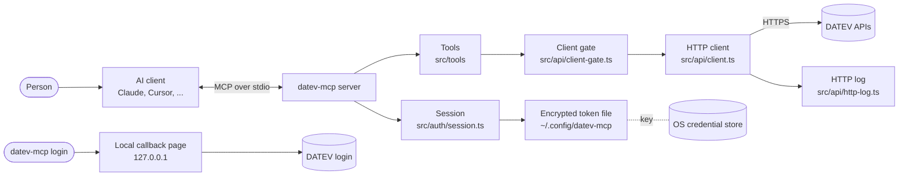

<!-- freshness: anchor -->
# Architecture

datev-mcp is a local MCP server. It runs on the same computer as the AI client, talks to the client over standard input and output, and talks to DATEV over HTTPS. There is no server of ours in between, no cloud component and no database.

## The big picture

## Layers

| Layer | Folder | Job |
|---|---|---|
| Entry and CLI | `src/index.ts` | Starts the MCP server, or runs a command such as `login`, `status`, `disconnect`, `services`, `doctor` or `compliance` |
| Server | `src/server.ts` | Registers the 18 tools, wires the session, the HTTP log and the revoke retry list |
| Tools | `src/tools/` | One file per group. Generic calls, accounting, documents, uploads, EXTF batches, connection control, compliance |
| API | `src/api/` | The HTTP client, the per-client gate, error parsing, permission checks, the HTTP log |
| Auth | `src/auth/` | OAuth with PKCE, the token client, the encrypted token store, revokes that DATEV has not yet confirmed |
| Setup | `src/setup/` | Login, status, disconnect, doctor, compliance report, token log |
| Spec | `src/spec/` | Builds `src/data/operations.json` from DATEV's API specifications. Neither the specs nor that file are published |

## How a read works

1. The AI client calls a tool, for example `datev_call` with an operation id.
2. The tool looks the operation up in the operation catalogue and checks the parameters against its schema.
3. For a client-bound product, the client gate reads the client from DATEV first. A client the user may not see is refused before anything else is sent.
4. The HTTP client sends the request with a fresh access token. A token that expires mid-session is refreshed once.
5. The answer is read up to a size cap. A large or broken error answer still keeps its status, title, help link and request id.
6. Before the answer reaches the AI client, DATEV's technical client id is replaced by `{client}`. The person sees the client's name and numbers instead.
7. The request and status are written to the HTTP log, which the error-rate check reads.

## How a write works

Writes never go out on the AI's word alone.

1. The tool first returns a preview of exactly what would be sent, with the client shown by name and numbers.
2. Against DATEV production, a person approves that preview in the AI client, which asks through MCP elicitation. A client that cannot ask is refused and nothing is sent. In the sandbox, when the client cannot ask, the preview's confirm code approves the write, unless `DATEV_MCP_CONFIRM=human` is set.
3. The write is sent. For EXTF booking batches a sent ledger records each file by a hash of its exact bytes, so the same file is not sent to DATEV twice by accident. A file exported again, for example with a new creation time in its header, counts as a new file, so the person still checks for duplicate bookings in DATEV.
4. When DATEV answers with a server error or a timeout, the answer says the change may already be applied and should be checked in DATEV before sending again.

## Tokens and sign-in

- `datev-mcp login` opens DATEV's login in the browser. DATEV sends the person back to a small page on `127.0.0.1`, which is only reachable from this computer.
- In production a local app with a `localhost` redirect must be registered at DATEV as a Public client, which has no client secret. The few APIs that require the client secret are then refused with a clear message, because DATEV offers them to Confidential clients only.
- Access and refresh tokens are kept in one file, encrypted with a random 256-bit key. On macOS and Linux the key lives in the operating system's credential store. On Windows it is a DPAPI-protected file next to the session, which only the same Windows user on the same computer can decrypt.
- The scopes the person picked at login decide which tools work. Refused permissions end only the login they belong to.
- `datev-mcp disconnect` revokes the tokens at DATEV and deletes them locally. A revoke that DATEV does not confirm is kept on a retry list until the token expires.

## What is deliberately not here

- No background polling. DATEV is called when a tool is used, and once at start-up to retry revoking a token DATEV did not confirm before.
- No database of client data. Answers pass through to the AI client. Two things are kept in an owner-only folder on this computer.
  - The technical HTTP log DATEV requires, kept at least 14 days. It holds request bodies and the answer body of failed requests and job status calls, which can contain client data.
  - The EXTF sent ledger, `sent-sandbox.json` or `sent-production.json`. For each uploaded batch it keeps the client id, file name, a hash of the file's exact bytes, time, job id and result, so the same file is not sent twice by accident. It is not pruned, because forgetting a batch would allow a duplicate send. `datev-mcp disconnect` leaves it in place.
- No DATEV specifications, descriptions or logos in this repository. See [TRADEMARKS.md](TRADEMARKS.md).

## Where to read more

- [SECURITY.md](SECURITY.md). Threat model and how tokens are protected.
- [DATEV-REVIEW.md](DATEV-REVIEW.md). What to show DATEV in the approval meetings.
- [PRODUCTION-APPROVAL.md](PRODUCTION-APPROVAL.md). The steps from sandbox to production.
- [REVIEW-LEDGER.md](REVIEW-LEDGER.md). Every review finding, its fix and the test that guards it.
